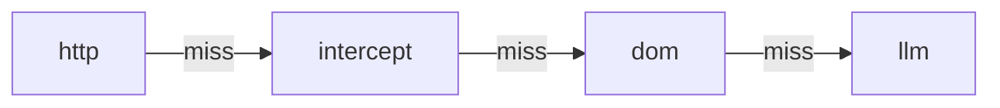

# Resolvers & Fallbacks

Notation Lenses executes a lens's `resolve` array in order from lowest cost to highest cost until every field in `returns` is satisfied. Choosing the right tier order keeps calls fast and resilient to markup changes.

## Resolver order

Prefer structured JSON sources before falling back to HTML selectors or agent extraction:



| Tier | Source |
| :--- | :--- |
| `http` | Direct HTTP requests made without loading the page |
| `intercept` | JSON responses captured while the page loads |
| `dom` | Rendered HTML elements matched by CSS selectors |
| `llm` | Page text and prompt handed back to the caller |

An `llm` tier never calls a model itself. It returns an `agent_extract` outcome holding `prompt`, page text, and any `gathered` fields from earlier tiers.

See [Resolvers Reference](../reference/resolvers.md) for every resolver field.

## Direct HTTP requests

Use an `http` tier whenever an endpoint returns JSON directly. Control cookie and origin context with `credentials`:

| Value | Behavior |
| :--- | :--- |
| `false` | Sends a direct request with no browser or cookies |
| `true` | Sends the request through the browser with site cookies |
| `"same-origin-page"` | Executes inside an open browser tab on the same origin |

By default, `credentials` is false. Individual entries inside `sources` can override `credentials` and add per-source request headers.

When one API endpoint depends on an ID from an earlier response, chain them in `sources` as in `examples/claude.usage.json`:

```json [claude.usage.json]
{
  "kind": "http",
  "credentials": true,
  "sources": {
    "orgs": {
      "request": { "method": "GET", "url": "https://claude.ai/api/organizations" }
    },
    "usage": {
      "request": {
        "method": "GET",
        "url": "https://claude.ai/api/organizations/{sources.orgs.body.0.uuid}/usage"
      }
    }
  },
  "map": {
    "plan": "$sources.orgs.body[0].rate_limit_tier",
    "limits": "$sources.usage.body.limits"
  }
}
```

Sources execute sequentially in declaration order, and any status outside `200` to `299` stops the chain and marks the tier as a miss.

## Intercepting page traffic

Use an `intercept` tier when an app calls internal JSON APIs during render that are difficult to invoke directly. Patterns match the full request URL using `*` wildcards.

| Option | Behavior |
| :--- | :--- |
| `reloadOnMiss` | Reloads the tab once when a required response has not been captured |
| `waitMs` | Polls up to the specified milliseconds for matching responses to arrive |

When `reloadOnMiss` is enabled, `waitMs` defaults to 8000.

Use `waitMs` without `reloadOnMiss` after `perform` steps so Lenses waits for action-triggered responses instead of reloading the page.

## DOM extraction and scope

Use `dom` when data exists only in rendered HTML. Set `scope` on a field to shift the selector's starting element relative to each `item` match:

| Scope | Starting element |
| :--- | :--- |
| `undefined` | Matches inside the current `item` element or document root |
| `"+"` | Moves to the immediately following sibling element |
| `"+ sel"` | Moves to the next sibling only if it matches `sel` |
| `".panel"` | Resolves the nearest matching `.panel` ancestor element |

`sibling: true` is the deprecated spelling of `"scope": "+"` and emits a validation warning.

When `attr` is omitted, a DOM field reads rendered text via `innerText`, falling back to `textContent` on non-HTML elements such as SVG. Horizontal whitespace runs including non-breaking spaces collapse to single spaces, `<br>` and paragraph breaks remain as line breaks, and outer whitespace is trimmed.

An existing element with no text returns `""`, whereas a selector that matches nothing returns `null`.

When an `item` selector matches zero elements, Lenses keeps the empty array if `returns` declares an array type. Otherwise, an empty array counts as a miss so later tiers can run.

## Follow-up links and recursive shapes

Declare a `$lens` reference directly inside `returns` to attach follow-up calls computed from sibling fields:

```json [hn.top.json]
{
  "returns": {
    "type": "array",
    "items": {
      "id": "string",
      "item_url": {
        "$lens": "@djgrant/hn/item",
        "params": { "id": "$item.id" }
      }
    }
  }
}
```

Lenses materializes `item_url` automatically without requiring resolvers to emit it.

If a parameter expression fails to bind, the field resolves to `null`. Emitting `null` explicitly in `post` or `map` suppresses the reference, while emitting a lens reference object preserves it verbatim.

For nested structures such as comment threads, define the repeating object once under top-level `$defs` and point to it with `$ref`:

```json [hn.comment.json]
{
  "$defs": {
    "comments": {
      "type": "object",
      "fields": {
        "id": "string",
        "text": "string",
        "replies": {
          "type": "array",
          "items": { "$ref": "comments" }
        }
      }
    }
  },
  "returns": { "$ref": "comments" }
}
```

## Partial-object reconciliation

When `returns` is an object, Lenses accumulates fields across tiers instead of discarding partial objects. A later tier fills only missing or `undefined` keys and never overwrites values set by an earlier tier.

Arrays and scalars are never merged across tiers. If an earlier tier returns an array or scalar that fails `returns`, later values are ignored.

When two or more tiers contribute fields that satisfy `returns`, the call result sets `"resolver": "reconciled"`. If all tiers finish with some fields still missing, Lenses returns the gathered object with `"partial": true` and skips caching.
