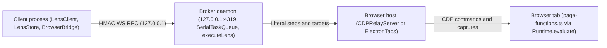

# Architecture

Notation Lenses splits schema validation, client caching, serial browser orchestration, and page injection across four runtime layers. Pure expression evaluation and tier selection stay independent of Chrome, while the daemon and host manage sockets, tabs, and CDP sessions.

## Layer responsibilities

Each layer owns a distinct boundary so lens specs remain declarative JSON documents and browser tabs stay isolated from Node state:

| Layer | Responsibility |
| :--- | :--- |
| Core | Spec validation, JSONata checking, `executeLens` tier walk, and `createCaptureBuffer` |
| Client | `LensStore` catalog resolution, parameter defaults, TTL cache, and `BrowserBridge` RPC |
| Broker | Loopback WebSocket server, `SerialTaskQueue`, write consent, and lazy browser startup |
| Browser host | `CDPRelayServer` with Chrome Playwright Extension or `ElectronTabs` in `app/` |

`@notation/lenses-core` executes lenses against an abstract `EngineIO` interface without importing Puppeteer, WebSockets, or filesystem modules. Only `page-stamp.ts` reads the `page-functions.ts` source file to fingerprint injected browser helpers.

## Trust and process boundaries

Lenses enforces strict boundaries between caller inputs, the broker process, and untrusted web pages:

- **Loopback WebSocket guard** – `BrowserBridge` refuses hosts other than `127.0.0.1`, and `broker-daemon.ts` rejects upgrades carrying an `Origin` header with HTTP 403.
- **Expression resolution before perform** – `runPerform` resolves JSONata values and `expandTemplate` holes inside the broker so the browser host receives only literal strings.
- **Lazy browser acquisition** – `broker-orchestrator.ts` binds a page session on first use, so pure HTTP calls and cache hits avoid touching Chrome.
- **Isolated page evaluation** – Functions in `page-functions.ts` serialize individually into `Runtime.evaluate` without closures over Node modules or broker state.

In the desktop app, `app/src/lens-tabs.ts` implements `ElectronTabs` over Electron's `webContents.debugger`. This lets `createElectronRelay` reuse the relay's tab model in-process without opening a Chrome TCP debugging port.
