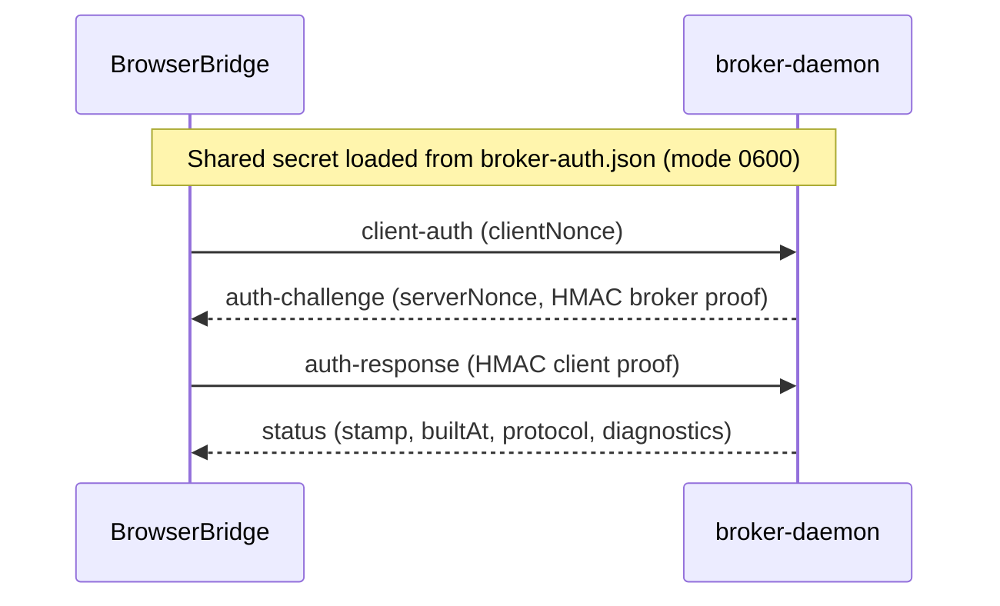

# Broker Lifecycle & Auth

Notation Lenses shares one background broker daemon per port on `127.0.0.1` across CLI invocations, TypeScript clients, and MCP servers. Clients spawn, authenticate with, and replace the daemon using atomic filesystem locks, build stamps, and HMAC-SHA256 challenges.

## Spawn, build judgment, and respawn

When `BrowserBridge.bind` connects to port 4319 (or a custom port), it runs up to 3 rounds of connecting or spawning a detached daemon with a 3000ms startup wait.

Once authenticated, `judgeBroker` compares the running daemon's `stamp`, `builtAt`, and `protocol` against the client build:

| Verdict | Condition |
| :--- | :--- |
| `use` | Matching stamp, compatible newer daemon, or busy older daemon |
| `retire` | Idle older daemon with an older `builtAt` timestamp |
| `refuse` | Newer daemon whose `protocol` differs from `BROKER_PROTOCOL` |

To prevent duplicate restarts when concurrent clients detect a stale broker, `coordinateRespawn` creates an atomic directory lock via `mkdirSync`. One caller requests an idle shutdown while peers wait up to 10000ms (with 60000ms stale-lock cleanup) and reconnect.

## Mutual auth and origin guard

The daemon rejects browser WebSocket upgrades in `verifyClient`: `brokerOriginAllowed` returns HTTP 403 whenever an `Origin` header is present. Native clients connect without an origin header and complete a mutual HMAC-SHA256 handshake within 5000ms:

`loadBrokerAuth` creates `broker-auth.json` with mode 0600 inside a 0700 directory and verifies proofs using `timingSafeEqual`.

## Serial queue and lifecycle timers

The daemon routes every `call` and `observe` frame through `SerialTaskQueue` so page binds, navigations, and captures never interleave.

If a call exceeds its deadline while `executeLens` is still running, `backgroundCall` remains active until settlement and new requests fail with `broker_busy`.

Four environment variables and constants govern idle release, exit, and graceful drain:

| Setting | Default and behavior |
| :--- | :--- |
| `LENS_BROKER_NO_BROWSER_EXIT_MS` | 10000ms exit delay when idle with no browser running |
| `LENS_BROKER_IDLE_EXIT_MS` | 900000ms exit delay when idle with a live browser |
| `LENS_BROKER_IDLE_RELEASE_MS` | 0ms disabled by default; delay before `requestLeaseRelease` |
| `DRAIN_TIMEOUT_MS` | 10000ms drain wait for in-flight calls during shutdown |

When hosted inside the desktop app, `idleExitMs` is forced to 0 because the app owns the broker lifetime. During shutdown, `createShutdownSequence` calls `stopListening()` before draining so a respawning client can rebind the port promptly.
