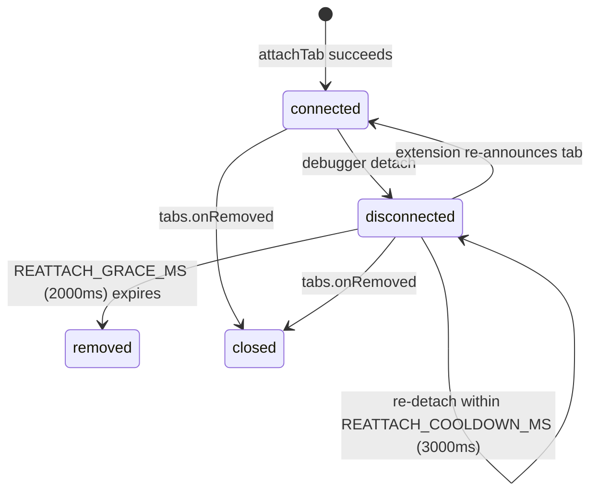

# Playwright Relay & Tabs

Notation Lenses connects to a user's live Chrome session through `CDPRelayServer` and the Playwright Chrome Extension instead of requiring a Chrome remote-debugging port. `ExtensionProtocolV2` and `BrowserModel` translate between Chrome extension debugger events and Puppeteer CDP sessions.

## Relay endpoints and anchor tab

`CDPRelayServer` binds an ephemeral loopback port on `127.0.0.1` with two UUID-scoped WebSocket paths: `/cdp/<uuid>` for Puppeteer and `/extension/<uuid>` for the extension.

`createPlaywrightExtensionBackend` opens the extension's `connect.html` page in Chrome and waits up to 45000ms for initialization, skipping approval prompts when `PLAYWRIGHT_MCP_EXTENSION_TOKEN` is set.

After connecting, `renderPlaywrightAnchor` opens a background **Lenses** status tab and closes the connect page. Closing that status tab triggers `requestLeaseRelease`.

## Tab link state machine and detach cooldown

Chrome detaches `chrome.debugger` from an entire tab whenever another extension injects a frame, such as a password manager's autofill popup. The extension re-announces detached tabs after 150ms unless they re-detach rapidly.

`REATTACH_GRACE_MS` waits 2000ms before treating a detach as a tab dragged out of the **Lenses** group. When a tab re-detaches within `REATTACH_COOLDOWN_MS` (3000ms), `BrowserModel` skips the removal timer so the tab stays disconnected during sign-in autofill.

## Tab handover across restarts

When a client restarts a stale broker, the extension ungroups existing tabs on disconnect. To preserve signed-in tabs across restarts, `prepareLeaseRelease` writes connected HTTP and HTTPS tabs to `tab-handover.json` with mode 0600:

| Phase | Behavior |
| :--- | :--- |
| Save | `saveHandover` writes `tabId`, `targetId`, and `url` per profile |
| Load | `takeHandover` reads and deletes the file within `HANDOVER_TTL_MS` |
| Adopt | `adoptTabs` re-attaches each `tabId` only if its `targetId` matches |

`HANDOVER_TTL_MS` expires handed-over tab records after 120000ms.

## Auth leases and Shadow DOM banner

`createBrokerAuthLeases` groups concurrent callers waiting on the same origin under one visible gate while keeping each caller's deadline and polling every 1000ms. Callers invoke `retain` and `close` so the gate survives gaps between retry polls without flickering.

In `cdp-host.ts`, `watchAuthGate` debounces main-frame `framenavigated` origin or pathname changes for 750ms before emitting a move exit.

`showAuthBanner` injects a closed Shadow DOM banner marked `[data-lenses-auth]` via `evaluateOnNewDocument`, keyed per tab so detached-debugger leftovers update in place.
