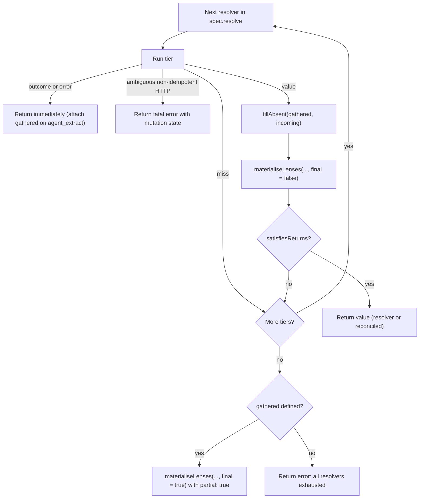

# Waterfall & Reconciliation

Notation Lenses executes each lens as a parameterised preflight followed by an ordered resolver waterfall. Rather than stopping at the first partial response, `executeLens` merges missing fields across tiers until the `returns` contract is satisfied or all resolvers finish.

## Parameter defaults and perform preflight

Before calling `executeLens`, the client resolves parameter defaults referencing other lenses through `applyRefDefaults` (capped at 8 calls and depth 4) and validates types and enums in `resolveParams`.

If the lens declares `perform` steps, `runPerform` runs before any resolver tier:

1. **Pre-step exception check** – When document `exceptions` exist, a lightweight `domExtract` reads the page URL and title and checks `matchPageException` so login walls abort before step 0.
2. **Literal step expansion** – JSONata values and `expandTemplate` holes resolve in the engine so `io.perform` receives only literal strings.
3. **Commit marker** – If all steps succeed, `executeLens` attaches `performed: true` to the final result, even if later reading fails.

## Tier waterfall and ambiguity lock

`resolveTiers` walks `spec.resolve` in declared order across HTTP, intercept, DOM, and LLM tiers:

If a non-idempotent mutating HTTP request fails after transmission (`transmissionAmbiguous`), `requestFailure` halts immediately with `mutation` state (`performed: "unknown"`) instead of falling back to another tier.

## Recursive merge and materialisation

Three core functions control how multi-tier objects settle against `returns`:

| Function | Behavior |
| :--- | :--- |
| `fillAbsent` | Copies missing or `undefined` keys recursively across plain objects without overwriting existing values |
| `materialiseLenses` | Expands declared `{$lens}` nodes using sibling `$item` fields and call `$params` |
| `satisfiesReturns` | Verifies every required field, `$defs` reference, array element, and file payload |

`fillAbsent` preserves earlier `null` values, scalars, and empty arrays without overwriting them, descending only when both current and incoming values are plain objects. If a later tier returns a non-object value after an earlier tier produced a result, that tier is ignored.

During the tier loop, `materialiseLenses` runs with `final` set to false so unbindable lens references that no resolver emitted stay `ABSENT` and fail `satisfiesReturns`, letting later tiers run.

Once tiers exhaust with a partial object, a final pass turns unbindable references into `null` and marks `partial: true`; when multiple tiers contributed, `resolver` becomes `"reconciled"`.
