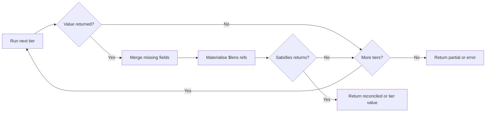

# Resolvers & Perform

Notation Lenses resolves a lens by executing optional `perform` browser steps once, then walking the `resolve` array in declaration order until `returns` is satisfied. Each tier produces a value, misses to the next tier, returns a terminal outcome, or stops with an error.

If every tier misses, Lenses returns an error beginning with `all resolvers exhausted`.

## `http`

An `http` resolver makes direct HTTP requests without loading the target page in a tab unless `credentials` requires a browser context.

| Field | Description |
| :--- | :--- |
| `kind` | Must be `"http"` |
| `request` | Object with `method` and `url` template |
| `body` | Request payload keyed by format for single requests |
| `sources` | Non-empty map of sequential named requests |
| `headers` | Map of request header templates |
| `credentials` | Context mode `false \| true \| "same-origin-page"` |
| `items` | JSONata expression over `$res` for single requests |
| `map` | JSONata expression or nested object projection |
| `exceptions` | Tier-specific exception rules evaluated before document rules |

Omitting both `request` and `sources` sends a GET request to the lens `url`. You cannot combine single-request fields with `sources` or place body or items at the tier root alongside it.

Each entry in `sources` requires `request` and accepts optional body, credentials, headers, and `items` fields. Sources execute sequentially, and any status outside 200 to 299 stops the chain and counts as a miss.

```json [claude-usage-http.json]
{
  "kind": "http",
  "credentials": true,
  "sources": {
    "orgs": {
      "request": { "method": "GET", "url": "https://claude.ai/api/organizations" }
    },
    "usage": {
      "request": {
        "method": "GET",
        "url": "https://claude.ai/api/organizations/{sources.orgs.body.0.uuid}/usage"
      }
    }
  },
  "map": {
    "plan": "$sources.orgs.body[0].rate_limit_tier",
    "limits": "$sources.usage.body.limits"
  }
}
```

### Request bodies and credentials

The `body` object accepts exactly one format key and is forbidden on `GET` and `HEAD` requests.

| Format | Payload behavior |
| :--- | :--- |
| `json` | Single expression serialized with `JSON.stringify` |
| `text` | Single expression converted with `String` |
| `form` | Map of expressions sent as multipart form entries |
| `search` | Map of expressions sent as URL-encoded form entries |

In `form` and `search`, arrays of scalars repeat the field entry, `null` becomes an empty string, and object values fail.

The `credentials` setting defaults to `false`, sending requests directly from the broker without cookies. Setting `true` sends cookies through a browser backend, while `"same-origin-page"` runs inside an open tab matching the request origin.

### Write HTTP methods and mutation safety

Any HTTP method other than `GET`, `HEAD`, or `OPTIONS` counts as a write and fails validation unless `effects.writes` is non-empty.

When a non-idempotent write request fails after transmission becomes ambiguous, Lenses aborts instead of falling back to later tiers. The returned error includes a `mutation` object reporting `performStarted: true`, `submissionMayHaveHappened: true`, and `performed: "unknown"`.

## `intercept`

An `intercept` resolver inspects JSON responses captured from the page's own network traffic without issuing requests itself.

| Field | Description |
| :--- | :--- |
| `kind` | Must be `"intercept"` |
| `request` | Single pattern with `method` and `*`-only `url` glob |
| `sources` | Non-empty map of named `{ request, items? }` patterns |
| `items` | JSONata expression over `$res` for single-pattern tiers |
| `map` | JSONata expression or nested object projection |
| `exceptions` | Tier-specific exception rules checked on captured responses |
| `reloadOnMiss` | Reloads the bound tab once when any pattern is missing |
| `waitMs` | Non-negative polling window in milliseconds for missing captures |

An `intercept` tier requires either `request` or `sources`, never both. When multiple sources are configured, `items` belongs on each source entry and every source must capture a response.

When `reloadOnMiss` is true and `waitMs` is omitted, polling defaults to 8000 milliseconds. Setting a wait window without reloading polls for responses triggered by earlier `perform` steps.

## `dom`

A `dom` resolver extracts values directly from the rendered page using CSS selectors.

| Field | Description |
| :--- | :--- |
| `kind` | Must be `"dom"` |
| `item` | Optional CSS selector template matching repeated row elements |
| `fields` | Map of field names to selector extraction specs |
| `post` | JSONata expression transforming the extracted value as `$value` |
| `exceptions` | Tier-specific exception rules seeing `$page`, `$value`, and `$params` |

When `item` is set, Lenses extracts one object per matching element; when omitted, it extracts a single object from the document root. If `post` returns `undefined` or `null`, the tier counts as a miss.

Each entry in `fields` specifies how to locate and read one property from its root element.

| Key | Behavior |
| :--- | :--- |
| `selector` | Required CSS selector template, or `":self"` for the root element |
| `attr` | Attribute name to read instead of rendered text |
| `scope` | Shifts the starting element before running `selector` |
| `sibling` | Deprecated boolean equivalent of `"scope": "+"` |

When `attr` is omitted, Lenses reads `innerText` and collapses horizontal whitespace while preserving line breaks, falling back to `textContent` on non-HTML elements.

Setting `attr` to `"href"` or `"src"` resolves non-empty attribute values to absolute URLs against `location.href`.

Setting `scope` to `"+"` moves to the next sibling element, and `"+ sel"` verifies that sibling matches.

Any other scope string calls `closest`, while using `sibling: true` alone emits a validation warning.

When `item` matches zero elements, Lenses keeps the empty array `[]` if `returns` accepts an empty array. Otherwise, the empty array counts as a miss so later tiers can run.

## `llm`

An `llm` tier never calls a model itself and never misses. It hands page text and any partial fields gathered so far back to the calling agent.

| Field | Description |
| :--- | :--- |
| `kind` | Must be `"llm"` |
| `prompt` | Required extraction instruction for the calling model |
| `maxSnapshotChars` | Positive integer character cap on page text |

When `maxSnapshotChars` is omitted, Lenses limits the snapshot to 20000 characters. The tier returns an `agent_extract` outcome containing `prompt`, page snapshot fields, and any `gathered` fields from earlier tiers.

## `perform` steps

A top-level `perform` array runs browser interactions sequentially before the first resolver tier executes. If any step fails, Lenses skips all resolvers and returns `perform_failed` with the 0-based `step` index, unless the landed page matches a declared exception.

| Step | Behavior |
| :--- | :--- |
| `fill` | Sets a single input, textarea, or contenteditable editor to `value` |
| `click` | Clicks the first visible, enabled match |
| `submit` | Populates `form` fields and calls native `requestSubmit` |
| `press` | Dispatches synthetic `keydown` and `keyup` events to the active element |
| `drop` | Stages a local file and dispatches drag-and-drop events |
| `wait` | Polls until a selector satisfies `appears`, `gone`, or `increases` |
| `navigate` | Reloads the lens URL when set to `"fresh"` |

Both `click` and `wait` support `a >>> b` syntax to pierce shadow roots and an optional `text` template selecting the innermost matching element.

```json [perform-example.json]
{
  "perform": [
    { "wait": { "appears": "#prompt-textarea", "timeoutMs": 10000 } },
    { "fill": "#prompt-textarea", "value": "$params.message" },
    { "click": "[data-testid='send-button']", "text": "Send" }
  ]
}
```

A `wait` step accepts `appears`, `gone`, or `increases`. The step timeout defaults to 10000 milliseconds, and an increasing wait samples its baseline count on entry.

A `drop` step requires `file` to be literally `"$params.<name>"` naming a declared string parameter with no `default`. Callers must supply a non-empty absolute local path at runtime.

Once every step finishes, Lenses sets `performed: true` on the call result even if later extraction fails. See [Write & File Lenses](../authoring/write-and-file-lenses.md) for authoring patterns.

## Tier reconciliation

When `returns` expects an object, Lenses merges partial values across tiers with `fillAbsent`, filling missing or `undefined` keys without overwriting existing keys. Nested plain objects merge recursively, whereas arrays and scalars never merge across tiers.



Before testing whether `returns` is satisfied, Lenses materialises declared `$lens` references. During intermediate passes, an unbindable reference whose field was never emitted stays `ABSENT` so later tiers can supply the missing sibling fields.

On the final pass, unbindable `ABSENT` references settle to `null`. Explicitly emitted `null` values stay `null` and block fallback filling for that key.

If two or more tiers contribute to the final object, `resolver` is `"reconciled"`. If all tiers finish with fields still missing, Lenses returns the gathered object with `partial: true` and skips caching. See [Resolvers & Fallbacks](../authoring/resolvers-and-fallbacks.md) for tier design guidance.
